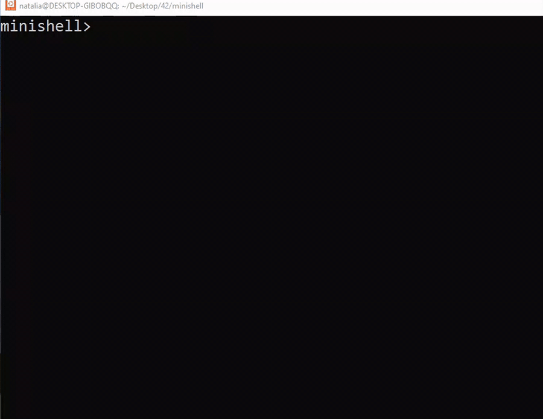

*This project has been created as part of the 42 curriculum by nakoriko, naal-jen.*

# minishell

## Description

**minishell** is a small Unix shell written in C, modeled on the behavior of `bash`.
The goal of the project is to understand how a shell works under the hood: reading
and parsing a command line, managing processes and file descriptors, handling
signals, and keeping track of the environment.

The shell shows a `minishell> ` prompt, reads input with GNU Readline (with command
history), and executes commands until it receives `exit` or `Ctrl-D`.



### Features

- **Executing commands** found through `PATH`, or given by a relative or absolute path
- **Quotes**
  - `'single'`: nothing inside is interpreted
  - `"double"`: only `$` is expanded
  - Unclosed quotes are reported as an error
- **Environment variable expansion**: `$VAR` and `$?` (exit status of the last command)
- **Redirections**
  - `<` input
  - `>` output (truncate)
  - `>>` output (append)
  - `<<` heredoc: the delimiter is expanded unless it is quoted
- **Pipes**: `cmd1 | cmd2 | ... | cmdN`
- **Built-in commands**

  | Builtin  | Behavior                                    |
  |----------|---------------------------------------------|
  | `echo`   | with the `-n` option                        |
  | `cd`     | relative or absolute path; updates `PWD` / `OLDPWD` |
  | `pwd`    | no options                                  |
  | `export` | supports `VAR=value` and `VAR+=value`; with no arguments, prints the sorted list |
  | `unset`  | no options                                  |
  | `env`    | no options or arguments                     |
  | `exit`   | with an optional numeric status             |

- **Signals**, as in interactive `bash`
  - `Ctrl-C` shows a new prompt on a new line
  - `Ctrl-D` exits the shell
  - `Ctrl-\` does nothing
- **Syntax checks** before anything runs: a pipe or redirection in the wrong place, a
  missing file name after a redirection, or an unclosed quote is reported with an error
  and exit status `2`

### How it works

```
readline ──► tokenizer ──► syntax check ──► token list ──► executor
             (parser/)     (parser/)        (parser/)      (pipes/, redirections/,
                                                            builtins/, execve/)
```

1. **Pre-parsing and splitting** ([parser/preparsing_split.c](parser/preparsing_split.c),
   [parser/parsing_main.c](parser/parsing_main.c)): the input is trimmed and split into
   words and operators (`|`, `<`, `>`, `<<`, `>>`). Quoted parts stay inside a single
   word, and variables are expanded at this stage
   ([parser/quotes_and_expansion.c](parser/quotes_and_expansion.c)).
2. **Syntax check** ([parser/parsing_check.c](parser/parsing_check.c)): the parser
   checks where operators appear before any command runs.
3. **Token list** ([parser/token_list_creation.c](parser/token_list_creation.c)): each
   word becomes a node in a linked list. Its type (`COMMAND`, `ARGUMENT`, `OPTION`,
   `PIPE`, `REDIRECTION_IN/OUT`, `APPEND_OUT`, `HEREDOC`, `FILENAME`, `DELIMITER`,
   `BUILTIN`) is set from its content and from the token before it. Quotes are then
   removed.
4. **Execution** ([parser/path_identifier.c](parser/path_identifier.c)): the shell
   checks for pipes first. A simple command then goes through redirections, builtins
   and `execve`, in that order. With pipes, each command is forked with its own file
   descriptors.

## Instructions

### Requirements

- `cc`
- `make`
- GNU Readline development headers
  - Debian/Ubuntu: `sudo apt install libreadline-dev`
  - macOS: `brew install readline`

### Build

```bash
make        # builds libft and the minishell binary
make clean  # removes object files
make fclean # removes object files and the binary
make re     # rebuilds from scratch
```

### Run

```bash
./minishell
```

Example session:

```bash
minishell> echo "Hello, $USER" | tr a-z A-Z
minishell> export GREETING=hi
minishell> echo $GREETING > out.txt
minishell> cat << EOF
> line with $HOME
> EOF
minishell> ls nonexistent
minishell> echo $?
minishell> exit
```

## Project structure

```
.
├── main.c, signals.c     # main loop, prompt, Ctrl-C / Ctrl-D / Ctrl-\
├── minishell.h           # shared structs and prototypes
├── parser/               # tokenizer, quotes, $ expansion, syntax check, token types
├── builtins/             # echo, cd, pwd, export, unset, env, exit (+ pipe versions)
├── redirections/         # <, >, >>, heredoc
├── pipes/                # pipeline setup and exit status
├── execve/               # PATH lookup, fork, execve
├── utils/                # memory cleanup, error output, helpers
└── libft/                # our libft, with get_next_line and linked-list helpers
```

## Testing

Tested with [LucasKuhn/minishell_tester](https://github.com/LucasKuhn/minishell_tester),
which runs each command in both `bash` and minishell and compares output, errors and exit codes:
**141/146** tests passed (builtins, pipes, redirects, extras).

Memory leaks can be checked with:

```bash
valgrind --leak-check=full --show-leak-kinds=all ./minishell
```

> **Note:** the `readline` library itself keeps some memory allocated until the program exits,
> so valgrind reports it as *still reachable*. These are not leaks in our code, and the
> 42 subject explicitly allows them. To hide them, run valgrind with a suppression file:
>
> ```bash
> echo '{ readline
>   Memcheck:Leak
>   ...
>   obj:*libreadline.so*
> }' > readline.supp
> valgrind --leak-check=full --show-leak-kinds=all --suppressions=readline.supp ./minishell
> ```

## Team

| Login      | Responsibilities |
|------------|------------------|
| **nakoriko** | **Parser**: splitting input into tokens, quote handling, `$VAR` / `$?` expansion, syntax checks and error messages, token typing and building the token list |
| **naal-jen** | **Execution**: builtins, pipes, redirections and heredoc, running commands with `execve`, signals, memory management |


## Resources

- [Bash Reference Manual](https://www.gnu.org/software/bash/manual/bash.html), in particular
  *Shell Operation*, *Quoting*, *Shell Expansions* and *Redirections*
- [GNU Readline Library](https://tiswww.case.edu/php/chet/readline/rltop.html)
- Man pages: `fork(2)`, `execve(2)`, `pipe(2)`, `dup2(2)`, `waitpid(2)`, `signal(2)`, `access(2)`
- [Writing Your Own Shell](https://www.cs.purdue.edu/homes/grr/SystemsProgrammingBook/Book/Chapter5-WritingYourShell.pdf), Purdue University
- *The Linux Programming Interface*, Michael Kerrisk: chapters on processes, pipes and signals

### Use of AI

We did not use AI tools to write the shell's code. AI was used only to polish this README.
